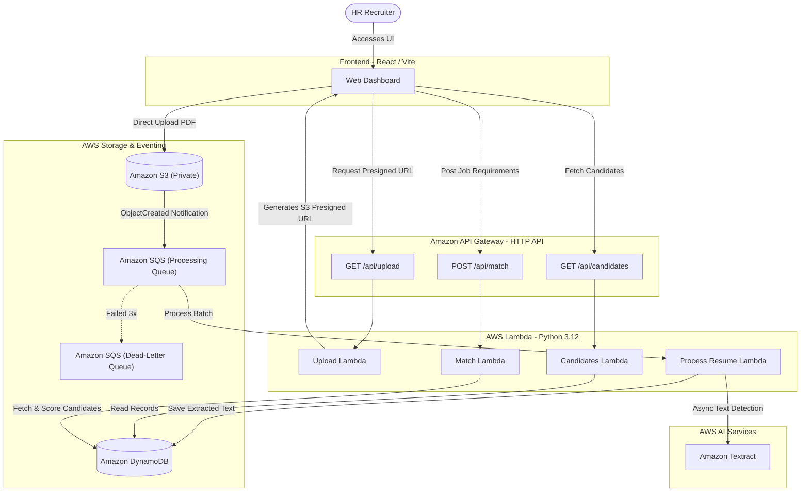

# 🎯 TalentLens — Cloud-Native AI Resume Screener

[](https://aws.amazon.com/lambda/)
[](https://aws.amazon.com/textract/)
[](https://www.python.org/)
[](https://react.dev/)
[](https://aws.amazon.com/dynamodb/)
[](https://aws.amazon.com/sqs/)

> Resume screening and skill matching powered by AWS Serverless & Amazon Textract AI.

TalentLens enables recruiters to upload PDF resumes, define job requirements, and rank candidates automatically through intelligent skill matching and asynchronous AI document processing.

---

## 🏗️ Architecture



---

## ✨ Features

- **Direct-to-S3 Uploads**: Presigned URL uploads avoid API Gateway payload limits.
- **Asynchronous Processing**: S3 → SQS → Lambda pipeline with automatic retries.
- **PDF Text Extraction**: Amazon Textract async document text detection for multi-page PDFs.
- **Keyword Skill Matching**: 80+ skills with aliases (e.g., "JS" → "JavaScript", "K8s" → "Kubernetes").
- **Match Percentage & Skill Tags**: Ranked results showing matched skills (green) and missing skills (red).
- **Dead-Letter Queue**: Failed messages retained 14 days for debugging.
- **Responsive Dashboard**: Clean React interface for uploading, matching, and reviewing candidates.

---

## 💻 Tech Stack

- **Frontend**: React 18, JavaScript, Vite, CSS
- **Backend**: Python 3.12, AWS Lambda
- **Infrastructure as Code**: AWS SAM (Serverless Application Model)
- **AWS Services**:
  - Amazon API Gateway (HTTP API with CORS)
  - Amazon S3 (private bucket for resumes)
  - Amazon SQS (processing queue + DLQ)
  - Amazon DynamoDB (candidate records, pay-per-request)
  - Amazon Textract (async document text detection)
- **Testing**: pytest (backend), Vitest + React Testing Library (frontend)

---

## 📋 Prerequisites

- **Node.js** v18+ and npm
- **Python** 3.12
- **AWS CLI** v2 configured (`aws configure`)
- **AWS SAM CLI** installed ([install guide](https://docs.aws.amazon.com/serverless-application-model/latest/developerguide/install-sam-cli.html))

---

## 📂 Project Structure

```
TalentLens/
├── backend/
│   ├── handlers/
│   │   ├── upload.py               # GET /api/upload → presigned S3 URL
│   │   ├── candidates.py           # GET /api/candidates → list all
│   │   ├── match.py                # POST /api/match → skill matching
│   │   └── process_resume.py       # SQS trigger → Textract → DynamoDB
│   ├── shared/
│   │   ├── response.py             # API Gateway response helpers
│   │   └── skill_extractor.py      # Keyword-based skill extraction engine
│   ├── tests/
│   │   ├── test_skill_extractor.py # 19 tests
│   │   ├── test_upload.py          # 6 tests
│   │   └── test_match.py           # 13 tests
│   ├── requirements.txt            # Lambda runtime dependencies
│   ├── requirements-dev.txt        # Dev/test dependencies (pytest, moto)
│   ├── template.yaml               # AWS SAM template
│   └── samconfig.toml              # SAM deployment config
├── frontend/
│   ├── src/
│   │   ├── components/             # Dashboard, ResumeUploader, CandidateCard, etc.
│   │   ├── api/api.js              # API client with snake_case→camelCase transform
│   │   ├── utils/skillMatcher.js   # Client-side skill matching
│   │   ├── App.jsx                 # Root component with state & polling
│   │   └── App.css                 # Complete stylesheet
│   ├── __tests__/                  # Vitest tests (12 tests)
│   ├── package.json
│   └── vite.config.js
├── docs/
│   └── aws-setup.md                # Step-by-step AWS deployment guide
└── README.md
```

---

## 🚀 Quick Start

### 1. Navigate to Project
```bash
cd TalentLens
```

### 2. Backend Setup
```bash
cd backend
pip install -r requirements-dev.txt
```

### 3. Frontend Setup
```bash
cd ../frontend
npm install
```

### 4. Run Tests
```bash
# Backend (from backend/)
python -m pytest tests/ -v

# Frontend (from frontend/)
npm test
```

### 5. Deploy to AWS
```bash
cd ../backend
sam build
sam deploy --guided
```
Follow the interactive prompts. Accept defaults or customize the stack name and region.

### 6. Configure Frontend
After deployment, note the **ApiUrl** output. Create a `.env` file in `frontend/`:
```bash
# Replace <api-id> and <region> with your actual values from sam deploy output
echo "VITE_API_URL=https://<api-id>.execute-api.<region>.amazonaws.com/api" > .env
```

> **Important**: The `VITE_API_URL` must include `/api` at the end. The ApiUrl output from SAM does NOT include this suffix — you must append it yourself.

### 7. Run Frontend
```bash
npm run dev
```
Open `http://localhost:5173` in your browser.

---

## ⚙️ How It Works

1. **Upload**: User selects a PDF resume. Frontend gets a presigned S3 URL from `GET /api/upload`, then uploads the PDF directly to S3.
2. **Process**: S3 fires an `ObjectCreated` event to SQS. The `ProcessResumeFunction` Lambda calls Textract for async text extraction, then saves the extracted text to DynamoDB.
3. **Poll**: Frontend polls `GET /api/candidates` every 5 seconds while any candidate is in `PROCESSING` status.
4. **Match**: Recruiter enters job requirements and clicks "Match Candidates". Frontend calls `POST /api/match`, which scores each candidate's resume against the requirements.
5. **Results**: Candidates are ranked by match percentage with matched/missing skill tags.

---

## 🔐 Environment Variables

| Variable | Scope | Description | Example |
|----------|-------|-------------|---------|
| `BUCKET_NAME` | Lambda (auto-set by SAM) | S3 bucket for resumes | `talentlens-resumes-123456789-us-east-1` |
| `TABLE_NAME` | Lambda (auto-set by SAM) | DynamoDB table name | `TalentLensCandidates` |
| `VITE_API_URL` | Frontend `.env` file | API Gateway base URL **with `/api` suffix** | `https://abc123.execute-api.us-east-1.amazonaws.com/api` |

---

## ☁️ AWS Deployment

For detailed step-by-step instructions, troubleshooting, cost estimates, and cleanup:

👉 **[AWS Deployment Guide](docs/aws-setup.md)**

---

## 📄 License

This project is licensed under the MIT License.
